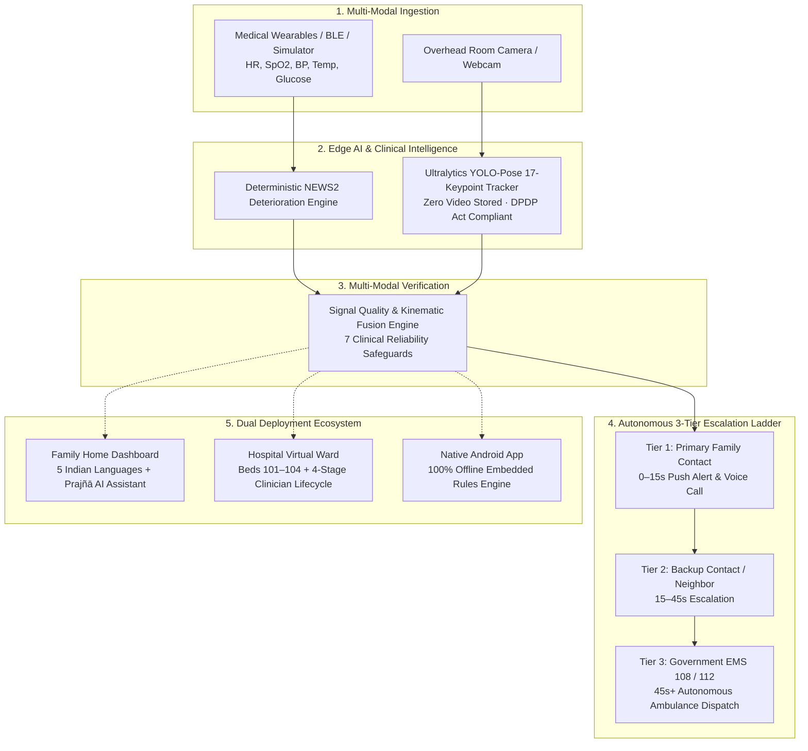

# Arohasetu — A Personal Nurse for Every Family & Hospital Bed

[](https://opensource.org/licenses/MIT)
[](https://mybharat.gov.in)
[](https://arohasetu.vercel.app)
[](https://arohasetu.vercel.app/downloads/Arohasetu-Demo.apk)

> Developed for **Hack for Social Cause (HSC) 2027** under the Viksit Bharat Young Leaders Dialogue (VBYLD 2027).  
> **Knowledge Partner:** IIT Bombay | **Organized by:** Ministry of Youth Affairs & Sports (MoYAS), Govt. of India.  
> **Target Region:** Andaman & Nicobar Islands (UT) & Pan-India Underserved Communities.

---

## 💡 What is Arohasetu?

**Arohasetu (आरोहासेतु)** is an affordable, privacy-first remote patient monitoring and autonomous emergency response ecosystem. Designed to solve India’s acute rural, island, and elderly healthcare crises, Arohasetu functions as a tireless, 24/7 personal nurse operating across two vulnerable environments:
1. **Home Care:** For elderly parents living alone while adult children work.
2. **Hospital "Virtual Wards":** For government and semi-urban hospitals where night nurse-to-patient ratios routinely exceed **1:30**.

---

## 🛡️ The Two-Layer Safety Shield



1. **Layer 1: Wearable Physiological Shield:** Ingests clinical vitals (Heart Rate, SpO2, Blood Pressure, Temperature, Respiratory Rate, Blood Glucose) scored against the gold-standard **NEWS2** (National Early Warning Score 2) deterioration matrix. Eliminates black-box generative AI hallucinations in clinical triage.
2. **Layer 2: Privacy-First Optical Sentinel:** Overhead room camera running on-device edge AI (**Ultralytics YOLO-Pose** 17-keypoint skeleton tracking). Detects sudden falls, prolonged floor stillness, and wandering. **100% video-private:** no video is ever recorded, stored, or streamed to the cloud (DPDP Act 2023 compliant).

---

## 🚀 Live Demo & Evaluator Accounts

* **Production URL:** [https://arohasetu.vercel.app](https://arohasetu.vercel.app)
* **Demo Logins:**
  * **Family Caregiver (Home Mode):** `asharma@demo.in` | Password: `demo123`
  * **Ward Nurse (Hospital Virtual Ward):** `wardnurse@demo.in` | Password: `demo123`
* **Admin Simulator (Evaluation Testing):** `/admin/simulator` (Protected by private developer passcode)
* **Native Offline Android App:** [Download APK (Arohasetu-Demo.apk)](https://arohasetu.vercel.app/downloads/Arohasetu-Demo.apk)

---

## ⚖️ Prototype Honesty (Real vs. Simulated)

In strict adherence to Hack for Social Cause 2027 academic integrity guidelines:
* **FULLY REAL IN CODEBASE:**
  * Complete responsive web application deployed on Vercel.
  * Deterministic NEWS2 clinical deterioration rules engine.
  * Hospital Virtual Ward with 4-stage clinician lifecycle (`New` &rarr; `Acknowledged` &rarr; `Follow-up Recorded` &rarr; `Resolved`).
  * On-device Ultralytics YOLO-Pose computer vision running on local GPU/CPU with 9.6ms snapshot response.
  * Native offline Android application with embedded rules engine and SharedPreferences storage.
  * Real-time dual-interface state synchronization (Admin &rarr; Judge in <1.8s).
  * Complete 5-language localization (English, Hindi, Bengali, Tamil, Telugu).
* **SIMULATED FOR SAFE LIVE DEMONSTRATIONS:**
  * **Physical Sensor BLE Pairing:** Controlled via the interactive Admin Simulator so evaluators can test emergency alerts without requiring physical medical wearables.
  * **Carrier Telecom Dial-Out:** Escalation logic, timing, retries, and dispatch sirens are 100% real code, but cellular connections to government 108/112 lines are simulated to prevent false emergency service dispatches.

---

## 🛠️ Quick Start & Local Execution

### Prerequisites
* Node.js 18+ and npm
* (Optional for local vision daemon) Python 3.10–3.12 with PyTorch & Ultralytics

### 1. Web Application & API
```bash
# Clone the repository
git clone https://github.com/EternalFlames131/Arohasetu.git
cd Arohasetu

# Install dependencies and start local server
npm install
npm start

# Application runs at http://localhost:8080
```

### 2. (Optional) Run Local YOLO Edge Vision Sentinel
```bash
# Windows launch script (auto-detects virtual environment)
tools\run_yolo.bat
# Vision daemon runs on http://localhost:5050
```

---

## 🧪 Automated Test Verification Suites

Arohasetu includes comprehensive test suites verifying clinical and kinematic reliability:

```bash
# 1. Run False-Positive Kinematic Lab Suite (23 multimodal elder-safety scenarios)
python tools/test_false_positive_lab.py
# Result: 23/23 PASSED (100%)

# 2. Run Fall Kinematics & Velocity Unit Tests
python tools/test_fall_kinematics.py
# Result: 7/7 PASSED (100%)
```

---

## 🤖 Official Disclosure on the Use of AI / Digital Assistance Tools

In accordance with Hack for Social Cause 2027 (MoYAS & IIT Bombay) rules:
* **Primary Human Authorship:** This project was **not** completely made through AI. All clinical problem analysis, system architecture, NEWS2 deterioration protocols, multi-tier escalation algorithms, and island healthcare grounding were authored and engineered directly by the human team.
* **Tools Utilized:** Google Antigravity (coding assistance environment).
* **Scope of Usage:** AI tools were used strictly as a minor programming assistant for writing a few code snippets, syntax boilerplate, and test runner formatting under human direction. Every line of logic was verified by the authors.

---

## 📜 License & Intellectual Property

This project is open-sourced under the **MIT License**. See [LICENSE](LICENSE) for details.  
All intellectual property remains with the innovating team in accordance with official competition guidelines.