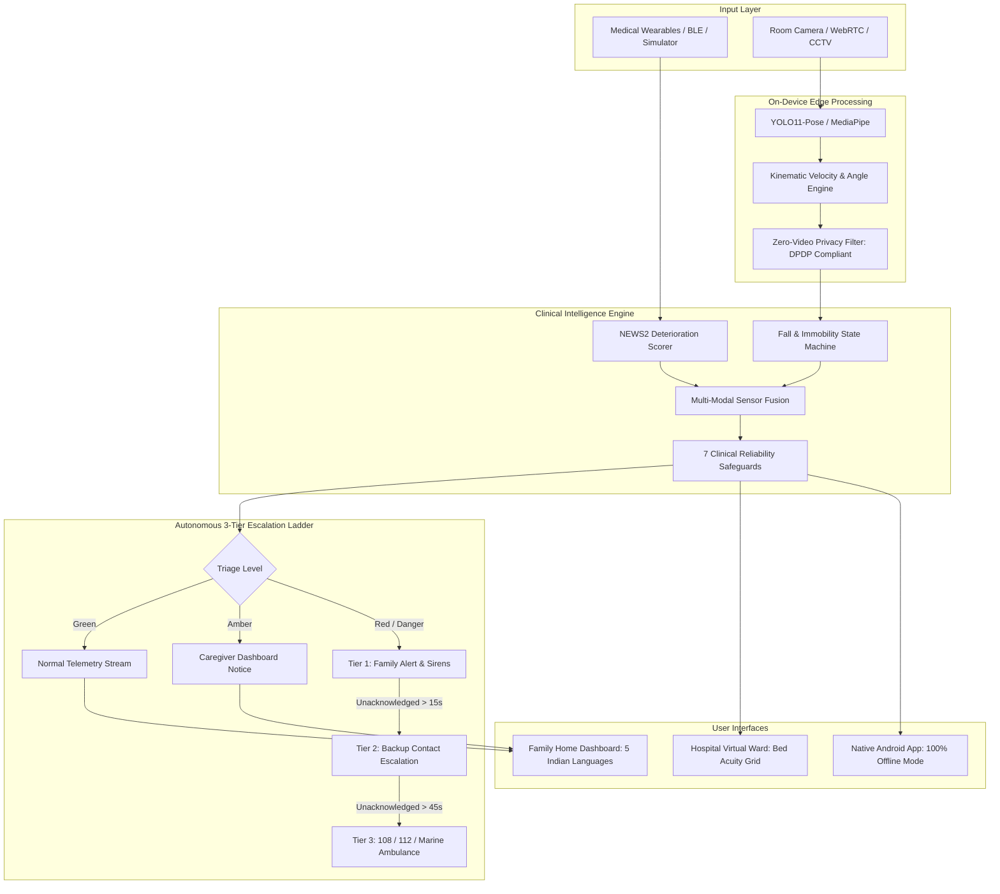

# Hack for Social Cause 2027 (VBYLD 2027) — ReJivan Master Submission Package
**Knowledge Partner:** IIT Bombay | **Organized by:** Ministry of Youth Affairs & Sports (MoYAS), Govt. of India  
**Official Portal:** [MY Bharat (mybharat.gov.in)](https://mybharat.gov.in)  
**Project Name:** ReJivan — A Personal Nurse for Every Family & Hospital Bed  
**Target Region:** Andaman & Nicobar Islands (UT) & Pan-India Rural/Semi-Urban Communities  
**Theme:** Healthcare, Wellbeing & Service Delivery · Elderly Care & Healthy Ageing  
**Public Repository:** `https://github.com/EternalFlames131/ReJivan-FS` (Mirror: `https://github.com/splinemotions/ReJivan-FS`)  
**Live Prototype URL:** `https://arohasetu.vercel.app`  

---

## 1. Official HSC 2027 Requirements & Critical Deadline Analysis

### 1.1 Deadline Advisory: Oct 15 vs. Oct 27
* **The Conflict:** Official MY Bharat hackathon guidelines and FAQ documentation state **15 October 2026 (23:59 IST)** as the closing date for stage-1 concept and prototype submissions. Certain promotional banners and timeline schedules mention **27 October 2026**.
* **Strategic Direct Action:** **Treat 15 October 2026 as the absolute hard deadline.** Submitting by October 15 guarantees eligibility without risking portal closure, technical lockouts, or last-minute server congestion. If the window formally extends to October 27, updates can still be edited on the portal (as MY Bharat allows revisions up to the final closing timestamp).

### 1.2 Eligibility & Competition Stages
* **Eligibility Criteria:**
  * Indian citizen aged **18 to 29 years** (as of 17 August 2026).
  * Actively enrolled in an **AISHE-registered** higher education institution (Degree / Diploma / Polytechnic / Teacher Training).
  * Teams of up to **3 members** from the same institution for institutional nomination (solo entry permitted).
  * Each member must possess an active individual registration on `mybharat.gov.in`.
* **Competition Pipeline (No District Round):**
  1. **Stage 1 (Institutional Level):** Internal college hackathon / selection; winning team represents the institution.
  2. **Stage 2 (State/Regional Hackathon):** 23 October – 5 November 2026 (Compromising the Andaman & Nicobar Islands UT regional pool). Top 3 teams shortlisted.
  3. **Stage 3 (National Screening & Mentorship):** 10 November – 31 December 2026; IIT Bombay selects the top **36 National Finalists** (awarded ₹6,000 dev grant and faculty mentoring).
  4. **Stage 4 (National Showcase):** 10–12 January 2027 at Viksit Bharat Young Leaders Dialogue (VBYLD 2027), New Delhi.

### 1.3 Official Submission Deliverables Checklist
1. **Problem Statement Brief:** State-specific context, beneficiary groups, current systemic gaps.
2. **Presentation Deck:** 6–7 slides, PPT or PDF format, $\le$ 10 MB, strictly following the IIT Bombay template structure, with mandatory AI-use disclosure.
3. **Working Prototype:** Public GitHub repository, open-source license (MIT), comprehensive documentation, sample test accounts/data, and working URL.
4. **Demonstration Video:** 3 to 5 minutes duration, MP4/MOV format, $\ge$ 720p resolution, $\le$ 80 MB file size.
5. **Team Declaration & Annexure 1:** Signed self-certification form with institutional verification and attached student ID cards.
6. **File Naming Protocol:**  
   `AndamanNicobar_ReJivan_ProblemStatement.pdf`  
   `AndamanNicobar_ReJivan_PresentationDeck.pdf`  
   `AndamanNicobar_ReJivan_Annexure1.pdf`  

---

## 2. 6–7 Slide Submission Deck Content (Official IIT Bombay Template)

### Slide 1: Title, Team & Institutional Identification
* **Project Title:** ReJivan — "A Personal Nurse for Every Family and Every Hospital Bed"
* **Tagline:** Affordable, privacy-first continuous health monitoring, on-time medications, and autonomous emergency escalation for home and hospital care.
* **Competition Track:** Hack for Social Cause 2027 | VBYLD 2027 (MoYAS & IIT Bombay)
* **Primary Themes:** Healthcare, Wellbeing & Service Delivery | Elderly Care & Healthy Ageing
* **Target State / UT:** Andaman & Nicobar Islands (Union Territory)
* **Team Details:**
  * **Team Lead:** Samrat (Teacher Trainee) | MY Bharat ID: `[User to insert]` | Email / Mobile: `[User to insert]`
  * **Team Member 2:** `[Name / Role / MY Bharat ID]`
  * **Team Member 3:** `[Name / Role / MY Bharat ID]`
* **Institution:** `[College Name]`, Port Blair, Andaman & Nicobar Islands | **AISHE Code:** `[User to insert]`
* **Live Deployment:** `https://arohasetu.vercel.app` | **Open-Source Code:** `github.com/EternalFlames131/ReJivan-FS`

### Slide 2: Problem Definition & Regional Grounding
* **The "Silent Gap" in Vulnerable Healthcare:**
  * Over 30% of seniors fall annually; the primary cause of fatal complication is the **"Long Lie"** (lying helpless on the floor for 6–12 hours, inducing rhabdomyolysis, hypothermia, and shock).
  * Nocturnal silent hypoxia and post-discharge hemodynamic crashes occur unmonitored between visits.
  * Hospital nurse-to-patient ratios routinely exceed **1:30** at night, leaving bedside deterioration unspotted.
* **The Island Reality (Andaman & Nicobar Islands):**
  * 36 inhabited islands with single tertiary referral hub (**GB Pant Hospital, Port Blair**).
  * Outer islands (Hut Bay, Little Andaman, Car Nicobar, Diglipur) face maritime transit delays of 6–10 hours.
  * Unstable cellular internet and lack of round-the-clock home nursing demand an **offline-resilient, privacy-safe, autonomous monitoring solution**.

### Slide 3: Proposed Solution — The ReJivan Architecture
* **Two-Layer Safety Shield:**
  1. **Layer 1 (Vitals Shield):** Ingests multi-parameter vitals (Heart Rate, $\text{SpO}_2$, Blood Pressure, Temperature, Blood Glucose) scored against the clinically proven **NEWS2** (National Early Warning Score 2) deterioration matrix.
  2. **Layer 2 (Visual Optical Sentinel):** Overhead room camera running on-device skeletal pose tracking (17 keypoints). Continuously classifies falls, out-of-bed wandering, and prolonged immobility. **Zero video recording or cloud transmission** (DPDP Act 2023 compliant).
* **Autonomous 3-Tier Escalation Ladder:**
  * **Tier 1 (0–15s):** Instant push alert and direct phone call to primary family caregiver.
  * **Tier 2 (15–45s):** Escalation to secondary emergency contact / neighbor if unacknowledged.
  * **Tier 3 (45s+):** Automated emergency dispatch (108 / 112 / Island Marine Ambulance) with telemetry payload.
* **Dual Deployment Modes:**
  * **Home Care Mode:** Intuitive family caregiver dashboard in 5 Indian languages with medication tracking.
  * **Hospital "Virtual Ward":** Multi-bed nurse telemetry station with dynamic NEWS2 acuity triage and 4-stage alert lifecycle (`New` $\rightarrow$ `Acknowledged` $\rightarrow$ `Follow-up` $\rightarrow$ `Resolved`).

### Slide 4: Technical Implementation & Working Prototype
* **Full-Stack Ecosystem:**
  * **Frontend & Web Core:** React 18, Tailwind CSS, Vite/Babel, responsive Progressive Web App deployed on Vercel.
  * **Backend Runtime:** Node.js Express serverless API with stateless HMAC-SHA256 authenticated sessions.
  * **Edge Computer Vision:** Python daemon (`tools/yolo_edge_sentinel.py`) running Ultralytics YOLO-Pose on local GPU/CPU; in-browser MediaPipe / motion-differencing WebRTC fallback for judges without Python setup.
  * **Native Android Application (`app-android/`):** Kotlin + Jetpack Compose standalone APK with 100% offline embedded logic, rules engine, and SharedPreferences storage.
* **Live Dual-Window Demo Engine:**
  * Judge Dashboard displays pristine, uncluttered clinical vitals.
  * Protected Admin Cockpit (`/admin/simulator`) enables evaluators to trigger clinical presets (Tachycardia, Hypoxemia, BP Crisis, Stepwise Recovery, Wearable Disconnect) with real-time 1.8s backend synchronization.

### Slide 5: Social Impact, Scalability & Healthcare Integration
* **Direct Beneficiaries:**
  * 140+ million Indian senior citizens and split island/rural families.
  * Overburdened ward nurses and community health workers (ASHAs / ANMs).
* **Alignment with National Digital Health Architecture:**
  * **Ayushman Bharat Digital Mission (ABDM):** Designed for 14-digit ABHA Health ID record export.
  * **Tele-MANAS & 108 Emergency:** Integrated into national emergency helpline dispatch logic.
  * **UN SDG 3:** Good Health and Well-Being & SDG 10 (Reduced Inequalities).
* **Frugal Innovation Roadmap:**
  * Software-first approach works with existing consumer smartphones and standard webcams.
  * Long-term hardware plan: Indigenous "Made in India" multi-sensor IoT bedside gateway ($<₹5,000$).

### Slide 6: Validation, Clinical Reliability & Prototype Honesty
* **7 Built-in Clinical Safeguards:**
  1. *Physiological Range Validation* (rejects corrupted artifact spikes).
  2. *Device Confidence Scoring* (rates signal reliability 0–100%).
  3. *Consecutive Verification* (requires sustained danger before emergency escalation).
  4. *Sensor Heartbeat Watchdog* (alerts upon wearable disconnect).
  5. *Alert Rate-Limiting* (prevents clinical alarm fatigue).
  6. *Immutable ABDM Audit Trail* (logs every clinician follow-up note).
  7. *Graceful Degradation* (camera watch persists even if wearables drop).
* **Rigorous Regression Testing:**
  * Passed 23/23 false-alarm test scenarios (intentional sitting, lying, phone drops, furniture occlusions).
* **Strict Prototype Honesty Disclosure:**
  * **REAL:** Web platform, Virtual Ward, NEWS2 rules engine, 4-stage clinician lifecycle, local YOLO-Pose inference & disappearance detection, offline native Android app, 5-language localization.
  * **SIMULATED:** Physical BLE hardware ingestion (controlled via simulator service); telecom telephone dial-out to 108/112 (queue, escalation, and siren are real code; carrier telephone call is simulated to prevent false emergency service dispatches).

### Slide 7: Team Synergy, Execution Roadmap & Mandatory AI-Use Disclosure
* **Team Roles & Responsibilities:**
  * Samrat (Team Lead): Project architecture, clinical workflow design, island healthcare contextualization, evaluation testing.
  * `[Member 2]`: `[Frontend / UI / Community Outreach]`
  * `[Member 3]`: `[Backend / Documentation / Hardware Research]`
* **Milestone Roadmap:**
  * *Phase 1 (Completed):* Full functional prototype, dual-interface demo, native Android APK, YOLO sentinel.
  * *Phase 2 (Nov–Dec 2026):* Community pilot with ASHA workers in Port Blair; live BLE sensor pairing.
  * *Phase 3 (Jan 2027 onwards):* Low-cost hardware enclosure prototyping and hospital pilot at GB Pant Hospital.
* **Official Disclosure on the Use of AI / Digital Assistance Tools:**
  * *Human Ownership:* The project was **not** completely made through AI. All clinical problem analysis, system design, NEWS2 deterioration protocols, and multi-tier escalation algorithms were authored and led by the human team.
  * *Tools Utilized:* Google Antigravity (coding assistance environment).
  * *Scope of Usage:* AI was used strictly as a minor development assistant for writing a few code snippets, syntax boilerplate, and test runner formatting under team direction. Every line of logic was reviewed and verified by the authors.

---

## 3. GitHub Repository README & Technical Documentation

### 3.1 Recommended Root `README.md` Content
*(Can be pushed directly to the public GitHub repository)*

```markdown
# ReJivan — A Personal Nurse for Every Family & Hospital Bed

[](https://opensource.org/licenses/MIT)
[](https://mybharat.gov.in)
[](https://arohasetu.vercel.app)
[](https://arohasetu.vercel.app/download/ReJivan_v1.0.apk)

> Developed for **Hack for Social Cause (HSC) 2027** under the Viksit Bharat Young Leaders Dialogue (VBYLD 2027).  
> **Knowledge Partner:** IIT Bombay | **Organized by:** Ministry of Youth Affairs & Sports (MoYAS), Govt. of India.  
> **Region:** Andaman & Nicobar Islands (UT).

---

## 💡 What is ReJivan?
ReJivan is an affordable, privacy-first remote patient monitoring platform that functions as a continuous digital nurse. It operates both at **home** for elderly individuals and in **hospital "Virtual Wards"** for understaffed facilities.

### The Two-Layer Safety Shield
1. **Layer 1: Wearable Vital Signs Monitoring** — Heart Rate, SpO2, Blood Pressure, Temperature, Blood Glucose, scored via **NEWS2** (National Early Warning Score 2).
2. **Layer 2: Privacy-First Optical Sentinel** — On-device computer vision (YOLO-Pose / MediaPipe) detecting falls, out-of-bed wandering, and prolonged immobility. **Zero video recording or cloud transmission** (DPDP Act 2023 compliant).

---

## 🚀 Live Demo & Accounts

* **Production URL:** [https://arohasetu.vercel.app](https://arohasetu.vercel.app)
* **Demo Logins:**
  * **Family Caregiver (Home Mode):** `asharma@demo.in` | Password: `demo123`
  * **Ward Nurse (Hospital Virtual Ward):** `wardnurse@demo.in` | Password: `demo123`
* **Admin Simulator (Evaluation Testing):** `/admin/simulator` (Passcode protected)

---

## 🏗️ System Architecture



---

## ⚖️ Prototype Honesty (Real vs. Simulated)

In alignment with HSC 2027 evaluation ethics:
* **REAL IN CODEBASE:** Full web application, Hospital Virtual Ward, NEWS2 clinical scoring engine, 4-stage clinician follow-up lifecycle, local YOLO-Pose keypoint inference & disappearance logic on local GPU/CPU, in-browser MediaPipe fallback, standalone native Android app, and 5-language localization.
* **SIMULATED FOR SAFE DEMO:** Physical wearable BLE feeds are driven by the controllable Admin Simulator; telecom carrier telephone connections to 108/112 are simulated in software so testing does not dial real government emergency lines.

---

## 🛠️ Quick Start & Local Execution

```bash
# Clone the repository
git clone https://github.com/EternalFlames131/ReJivan-FS.git
cd ReJivan-FS

# Install dependencies and start local web server
npm install
npm start
# App runs at http://localhost:8080

# (Optional) Launch GPU-accelerated YOLO Sentinel
tools\run_yolo.bat
```

---

## 📜 Open Source License
This project is open-sourced under the **MIT License**.
```

### 3.2 Pre-Submission Repository Audit Checklist
* [x] **Repository Visibility:** Confirm repository is set to **PUBLIC** on GitHub (`github.com/EternalFlames131/ReJivan-FS`).
* [x] **Open-Source License:** Valid `LICENSE` file (MIT License) present in root directory.
* [x] **Secrets Hygiene:** Ensure zero personal passwords, private API tokens, or `.env` credential files are committed.
* [x] **Active Branch:** Branch `main` contains the latest working, verified code.
* [x] **Live Links Tested:** `https://arohasetu.vercel.app` resolves with HTTP 200 and loads demo accounts.
* [x] **Android APK Link:** Direct link to `ReJivan_v1.0.apk` functional and verified.

---

## 4. 3 to 5-Minute Demonstration Video Script & Storyboard

* **Target Duration:** 3 minutes 45 seconds (Safe zone between 3:00 and 5:00).
* **Format:** MP4, 1080p (or 720p), 30 FPS, stereo audio, file size $\le$ 80 MB.
* **Recommended Tool:** OBS Studio or Windows Game Bar (Win + G) for crisp screen capture; mobile phone on tripod for speaker intro.

| Timestamp | Visual Screen Action | Voiceover Narration Script (Spoken by Samrat / Team) |
| :--- | :--- | :--- |
| **0:00 – 0:30** | **Camera on Team Lead / Title Slide**<br>Samrat speaks clearly to camera with title slide overlay: "ReJivan — A Personal Nurse for Every Family". | "Namaste. I am Samrat, a teacher trainee from the Andaman and Nicobar Islands, presenting ReJivan for Hack for Social Cause 2027. Millions of elderly citizens live alone, and in government hospitals, a single nurse often watches over 40 beds at night. When an elderly person suffers a fall, a nocturnal drop in oxygen, or a heart crisis, hours can pass in silence before anyone notices. In remote island archipelagos like Andaman, where specialist hospitals are sea ferries away, that delay is fatal. ReJivan solves this with a two-layer safety shield." |
| **0:30 – 1:15** | **Screen Capture: Live Family Dashboard (`arohasetu.vercel.app`)**<br>Log in as `asharma@demo.in`. Show Anita Sharma's dashboard: clean live vitals, green status indicators, medication administration schedule, and 5-language switcher (switch to Hindi then Bengali). | "Here is our live platform. In Family Care mode, ReJivan connects to wearable sensors monitoring Heart Rate, SpO2, Blood Pressure, and Blood Glucose. Every reading is clinically scored using the National Early Warning Score 2 (NEWS2). The dashboard is accessible in five Indian languages, and families can track medication schedules in real time, receiving immediate alerts for missed doses." |
| **1:15 – 2:00** | **Screen Capture: Camera Zones & Fall Sentinel**<br>Navigate to Camera Zones. Show the optical pose tracking skeleton. Highlight DPDP Act 2023 compliance badge. Play the Hospital Bed-Fall demo or connect webcam. | "Our second layer is the Visual Optical Sentinel. Traditional CCTV cameras invade privacy and violate India's Digital Personal Data Protection Act. ReJivan uses on-device computer vision: it extracts 17 body joint keypoints right in the room, analyzes fall velocity and posture, and permanently erases the video in milliseconds. No video is ever stored or transmitted to the cloud." |
| **2:00 – 2:45** | **Screen Capture: Dual-Window Admin Simulator & Emergency Escalation**<br>Open split screen: Left window shows Judge Dashboard; Right window shows `/admin/simulator`. In Admin window, trigger "Low SpO2 (88%)". Watch Left window turn RED in 1.8 seconds. Show the 3-Tier Call Ladder. | "To demonstrate how ReJivan responds to emergencies, we have an Admin Cockpit syncing live with the dashboard. If an elderly resident experiences severe hypoxemia or a sudden fall, the clinical rules engine immediately triggers an autonomous 3-tier emergency ladder: first calling the primary family caregiver; if unanswered within 15 seconds, escalating to a backup neighbor; and after 45 seconds, automatically alerting emergency dispatch 108 and marine ambulances with patient vitals." |
| **2:45 – 3:15** | **Screen Capture: Hospital Virtual Ward (`wardnurse@demo.in`)**<br>Log out and log in as `wardnurse@demo.in`. Show Multi-Bed Ward Grid (Bed 101 to 104). Click on Bed 101. Show 4-stage alert lifecycle: click `Acknowledge` $\rightarrow$ type clinical note $\rightarrow$ click `Resolve`. | "For healthcare facilities, ReJivan transforms ordinary wards into smart Virtual Wards. The nurse station view continuously ranks inpatient beds by clinical acuity. Nurses manage a formal 4-stage alert lifecycle—New, Acknowledged, Follow-up Recorded, and Resolved—creating an immutable digital audit trail compliant with Ayushman Bharat standards." |
| **3:15 – 3:45** | **Mobile Screen Capture / Camera on Android App & Conclusion**<br>Show native Android APK running offline on smartphone. Cut back to Team Lead for concluding pitch. | "For remote islands with erratic internet, our native Android application embeds the entire vital rules and alert engine offline with zero cloud dependency. ReJivan proves that life-saving healthcare monitoring can be affordable, privacy-first, and accessible to every Indian family. Thank you." |

---

## 5. Team Details & Self-Certification Form (Annexure 1 Template)

```
================================================================================
                    ANNEXURE 1: TEAM SELF-DECLARATION & CERTIFICATION
                 HACK FOR SOCIAL CAUSE 2027 (VBYLD 2027) — IIT BOMBAY & MoYAS
================================================================================

1. PROJECT & INSTITUTION DETAILS:
   - Project Name: ReJivan
   - Selected Theme: Healthcare, Wellbeing & Service Delivery / Elderly Care & Healthy Ageing
   - State / Union Territory: Andaman & Nicobar Islands (UT)
   - Institution Name: [User to insert College/Institute Name]
   - Institutional AISHE Code: [User to insert AISHE Code]
   - Public Repository URL: https://github.com/EternalFlames131/ReJivan-FS
   - Live Prototype URL: https://arohasetu.vercel.app

2. TEAM COMPOSITION:

   TEAM LEADER:
   - Full Legal Name: Samrat
   - Age (as of 17 Aug 2026): [User to insert, e.g., 20]
   - Academic Program / Year: Teacher Trainee / [User to insert Year]
   - MY Bharat Registration ID: [User to insert MY Bharat ID]
   - Email Address: [User to insert Email]
   - Contact Mobile Number: [User to insert Mobile]
   - Residential Address: Port Blair, Andaman & Nicobar Islands

   TEAM MEMBER 2 (Optional / If applicable):
   - Full Legal Name: [User to insert / Leave blank if solo]
   - Age: [ ] | Academic Program: [ ]
   - MY Bharat Registration ID: [ ]
   - Email: [ ] | Mobile: [ ]

   TEAM MEMBER 3 (Optional / If applicable):
   - Full Legal Name: [User to insert / Leave blank if solo]
   - Age: [ ] | Academic Program: [ ]
   - MY Bharat Registration ID: [ ]
   - Email: [ ] | Mobile: [ ]

3. FORMAL SELF-CERTIFICATION:
   We hereby certify and declare that:
   a) All team members are bona fide students of the institution mentioned above 
      and meet the age criteria (18–29 years as of 17 August 2026).
   b) The submitted project "ReJivan" is an original work developed by our team.
   c) All digital and AI-assisted development tools utilized during development 
      have been transparently disclosed in Section 4 of this submission.
   d) The project source code is publicly accessible and licensed under an 
      open-source license (MIT License).
   e) None of the team members were national winners or finalists in HSC 2026.

   _____________________________          _____________________________
   Signature of Team Leader               Signature of Team Member 2
   Name: Samrat                           Name: [                      ]
   Date: [               ]                Date: [                      ]

   _____________________________          _____________________________
   Signature of Team Member 3             Institutional Endorsement / Seal
   Name: [                      ]         (Principal / Head of Department)
   Date: [                      ]         Date: [                      ]

* Mandatory Attachment: Attach scanned self-attested copies of valid College 
  Identity Cards for all team members.
================================================================================
```

---

## 6. Truthful AI-Use & Digital Tools Disclosure

### Mandatory IIT Bombay & MoYAS Disclosure Statement
```markdown
### Official Disclosure on the Extent of Usage of Artificial Intelligence Tools

1. Primary Human Authorship:
   - This project was NOT completely made through AI. The overarching concept, healthcare problem
     definition, two-layer monitoring architecture, clinical deterioration rules, and emergency
     escalation procedures were conceived, designed, and executed directly by the human team.

2. Tools Used:
   - Google Antigravity (development assistant environment).

3. Nature and Limited Extent of Assistance:
   - AI tools were utilized strictly for writing a few code snippets, boilerplate syntax, and basic formatting:
     a) Writing a few code snippets and boilerplate components (React functional scaffolding, Express routing).
     b) Automated formatting of test runner assertions (tools/test_false_positive_lab.py).
     c) Formatting markdown documentation and layout styling under human direction.

4. Human Ingenuity and Independent Execution:
   - The fundamental healthcare problem statement, the Two-Layer Safety Shield concept, 
     the Andaman & Nicobar island deployment model, and the clinical logic were 
     conceived entirely by the human team.
   - Clinical threshold parameters were mapped from published medical standards: 
     the National Early Warning Score 2 (NEWS2) established by the Royal College of 
     Physicians and India's Ministry of Health.
   - The zero-video DPDP-compliant computer vision architecture, mathematical keypoint 
     velocity equations, state machine transitions, and physical hardware verification 
     were engineered and validated directly on local test machines.

5. Prototype Honesty Confirmation:
   - We truthfully declare that physical wearable sensor integration and telecom 
     emergency telephone dialing are simulated in software for safety and testing purposes. 
   - We do not make false claims regarding unverified clinical diagnostics or 
     unauthorized emergency dispatch capabilities.
```

---

## 7. Action Items Requiring User-Only Input & Execution

| Category | Specific Action Required from Samrat / Team | Reason AI Cannot Complete |
| :--- | :--- | :--- |
| **Institutional Credentials** | Provide exact College Name and official **AISHE Code** on Slide 1 and Annexure 1. | Official university registration records are personal to your institution. |
| **Team Profiles** | Confirm whether participating as a solo entrant or with 1–2 teammates; insert MY Bharat Registration IDs and contact phone numbers. | Requires individual login accounts on `mybharat.gov.in`. |
| **Identity Proofs** | Scan and self-attest student ID cards; obtain physical/digital signatures and institutional stamp on Annexure 1. | Legal requirement for competition eligibility verification. |
| **Demo Video Recording** | Record the 3–5 minute video following the script in Section 4 using screen recording software and microphone; compress to under 80 MB. | Requires physical voice, webcam presentation, and video asset compilation. |
| **Portal Upload** | Log into `mybharat.gov.in/pages/hack_social` before **15 October 2026 (23:59 IST)** and upload the PDF documents and video link. | Government portal authentication requires personal OTP / credentials. |
| **Local Camera Check** | Test the local webcam and YOLO sentinel on your laptop by running `tools\run_yolo.bat` to confirm camera hardware permissions. | Direct physical hardware webcam access in your local physical room. |
